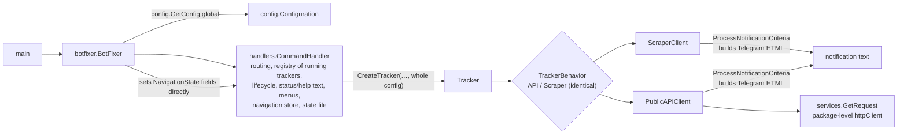
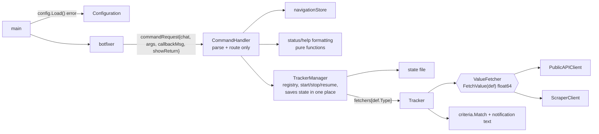

# SOLID refactoring plan

**Model:** Claude Opus 5.5 (`claude-opus-5-5`), Claude Code desktop app
**Date:** 2026-10-15, branch `refactor-tests`
**Prompt:** explore the project and make a plan for SOLID refactoring. Written before reading any of the other plans in the repo root.

Plan only, nothing is implemented. References to the project docs use their headings: `AGENTS.md` "Gotchas", `MIGRATION_PLAN.md` §6 / §7.

---

## 1. Ground rules

- **No visible behavior change** unless a step says so: same commands, messages, buttons, env vars, tracker JSON field names and state file format (`savedTracker`).
- **One step = one PR**, each leaves `golangci-lint run ./...` and `go test -race ./...` green. The existing tests (fake messenger in `handlers/tracker_test.go`, fake Telegram server in `botfixer/bot_fixer_test.go`) are the safety net; new seams get table tests first.
- **No new packages unless a step needs one**, no DI container, no "manager of managers". The project is ~2,000 lines of production code; the target is fewer reasons to change per type, not more types.

---

## 2. What the code looks like today

What is already good and stays: `Tracker` run loop, `backoffDelay` (pure, tested), `services.HTTPStatusError`, the `helpers.Messenger` interface, the `commandMap` registry (already the extension point for new commands), atomic state-file writes.

---

## 3. Findings

| # | Principle | Problem | Evidence |
|---|---|---|---|
| F1 | SRP | `CommandHandler` has 7 jobs: parse/route, running-tracker registry + mutex, start/stop/resume orchestration, status/help text, menu building, per-chat navigation store, state persistence. | `handlers/command_handler.go` (575 lines), `saveState`/`ResumeTrackers` in `tracker_state.go` are `CommandHandler` methods; `ch.saveState()` is called from 7 places (6 in `command_handler.go`, 1 in `ResumeTrackers`). |
| F2 | SRP | Clients fetch **and** evaluate notification criteria **and** write Telegram HTML. | `clients.ProcessNotificationCriteria` called at the end of both `FetchAndExtractData`; HTML operator escaping duplicated in `helpers.FormatNotificationCriteriaString`. |
| F3 | SRP | `Command` is used for two things: a registry entry (`Params` = parameter *names*) and a navigation-history entry (`Params` = argument *values*, `Command` field set only here). | `HandleCommand` pushes `&Command{Command: …, Params: …}`; `HandleReturn` and `HandleUserInput` rebuild the command string with the same duplicated code. |
| F4 | SRP / encapsulation | Request data travels through shared per-chat state instead of parameters: `HandleCommand` stores `callbackMessageID` in `NavigationState`, handlers read it back later; `botfixer` sets `BackButtonEnabled` on the handler's state directly. Works only because updates are serialized (`updateMu`). | `update.go` `handleMessage`/`handleButton`; `handleSetInterval`, `handleStatus`, `setNotificationsPaused`, `handleCommandMessage`. |
| F5 | OCP | The two tracker types are hard-coded in 6 places. A third type (e.g. XPath, headless browser) means editing all of them. | `Configuration.APITrackers/ScraperTrackers`, `GetAPITrackerData`/`GetScraperTrackerData`, `DetermineTrackerType`, the `switch` in `CreateTracker`, two loops each in `startAllTrackers` and `handleStatus`. |
| F6 | LSP / dead code | `clients.Client` declares `FetchAndExtractData(trackerCode string)`, but both clients take `*config.Tracker` — nothing implements or uses it. `APITrackerBehavior` and `ScraperTrackerBehavior` are line-for-line identical apart from the client type. | `clients/client.go`, `handlers/tracker_behavior.go`. |
| F7 | DIP | `CreateTracker` creates its behavior with `New…TrackerBehavior()`, so tests can't inject one and build `Tracker` as a struct literal instead (`newTestTracker`). | `handlers/tracker.go`, `handlers/tracker_test.go`. |
| F8 | ISP | `CreateTracker` takes the whole `*config.Configuration` but needs the tracker definition, `MinInterval` and `ErrorNotifyLimit`. `Tracker` needs 2 of the 6 `Messenger` methods. | `CreateTracker`, `executeTrackerLogic`, `recordError`. |
| F9 | DIP | `main` is not the composition root: `NewBotFixer()` pulls the global `config.GetConfig()`, which caches a package variable and calls `log.Fatalf` (also inside `ValidateConfig`). Errors can't be tested or handled by the caller. | `config/config.go`, `botfixer/bot_fixer.go`. |
| F10 | Cohesion | `helpers` mixes Telegram transport (`TelegramMessenger`), menus, domain logic (`CompareNumbers`) and text formatting. | `helpers/*.go`. |

---

## 4. Target shape

---

## 5. Steps

Ordered so each one is small, shippable and makes the next one easier. Effort: S < 1h, M = a few hours, L = a day.

### Step 1 — Remove dead code and duplication (S, no behavior change)

- Delete `clients.Client` (replaced properly in step 2) and the unused `NavigationState.IsEmpty`.
- Replace the two hand-written `<`/`>` escapes with `html.EscapeString`.
- Name the repeated `"02.01.2006 15:04"` layout as a constant.
- Fix the stale `ParseDurationWithDays` doc comment (it says it defaults to 24h on failure; it returns an error).

### Step 2 — Clients only fetch a number (SRP, LSP; M)

- New interface next to its consumer in `handlers`: `type ValueFetcher interface { FetchValue(def *config.Tracker) (float64, error) }`. `PublicAPIClient` and `ScraperClient` implement it; `DataResult` and the `ProcessNotificationCriteria` calls go away. The API client returns the float directly instead of float → `"%f"` string → `ParseFloat`.
- Criteria evaluation becomes a pure function: `criteria.Match(list []config.NotifyCriteria, value float64) ([]config.NotifyCriteria, error)` with `CompareNumbers` moved next to it (small `criteria` package, or `config` if a new package feels like too much).
- The notification text moves to the presentation side (`handlers/messages.go`): `formatMatchMessage(code, value, matched, viewURL)`.
- `TrackerBehavior` and both behavior structs collapse into `Tracker` holding a `ValueFetcher`; `executeTrackerLogic` does fetch → match → format → send.
- Tests: client tests assert the returned float; `TestScraperClientNotification` becomes a `criteria.Match` table test (covers every operator and an invalid one — closes the `MIGRATION_PLAN.md` §7 open item for `CompareNumbers`); `fakeBehavior` becomes `fakeFetcher`.

### Step 3 — Register tracker types once (OCP; M)

- Keep both env vars, both files and the JSON format. While loading, `config` tags each definition with `Type` (`json:"-"`, `"api"` / `"scraper"`) and exposes `Trackers()` (API first, then scraper — the current display order) and `Tracker(code)`.
- `handlers` gets the fetchers as a map built in `main`: `map[string]ValueFetcher{"api": clients.NewPublicAPIClient(), "scraper": clients.NewScraperClient()}`. One instance per type is enough: both clients are stateless (the colly collector is already created per call, `AGENTS.md` "Gotchas").
- Removed: `DetermineTrackerType`, `GetAPITrackerData`, `GetScraperTrackerData`, the duplicated loops in `startAllTrackers` and `handleStatus` (the status line prints `def.Type`).
- A new type afterwards = one client + one map entry + one env var.
- **Behavior change to decide:** reject a code defined in both files at load time. Today the API definition silently wins.

### Step 4 — Tracker gets only what it uses (ISP, DIP; S)

- `CreateTracker(messenger, code, interval, config, chatID)` becomes `newTracker(def *config.Tracker, fetcher ValueFetcher, notifier notifier, interval time.Duration, chatID int64, errorLimit int)`; the minimum-interval clamp moves to the caller in step 5, next to the `handleSetInterval` check (`AGENTS.md` "Minimum interval": keep both in sync — now they sit in one type).
- `type notifier interface { SendHTML(…); SendHTMLWithMenu(…) }` in `handlers`; `helpers.Messenger` satisfies it implicitly.
- `newTestTracker` uses the real constructor.

### Step 5 — Split `CommandHandler` (SRP; L — the main step)

All inside package `handlers`, one file per type:

| New type / file | Takes over | Notes |
|---|---|---|
| `TrackerManager` (`tracker_manager.go`) | `runningTrackers` + `mu`, `GetActiveTracker`, `Add/RemoveRunningTracker`, `startTracker`, `startAllTrackers`, `StopAllTrackers`, interval/mute changes, `saveState`, `ResumeTrackers` | Every mutating method saves the state file itself, so the 7 scattered `ch.saveState()` calls disappear. Lock order stays manager → tracker (as in today's `saveState`). |
| `navigationStore` (`navigation_state.go`) | `navigation` map + `navigationMu`, `GetUserNavigationState` | History entries become `navigationEntry{command string, args []string}` with one `String()` used by `HandleReturn` and `HandleUserInput` (fixes F3). |
| status/help formatting (`status_view.go`) | text building in `handleStatus`, `handleHelp`, `processTrackerStatus`, `formatCommandWithParams`, the error-limit text in `recordError` | Pure functions over `TrackerStatus` / definitions → table tests. Help lists commands sorted (today it ranges over a map, so the order changes between calls). |
| `CommandHandler` | parse, route, call command funcs, `handleCommandMessage` (send vs edit) | Each command func becomes a few lines: manager call → view call → reply. |

The state file functions `readStateFile`/`writeStateFile` stay as they are; no `StateStore` interface — the round-trip tests already use `t.TempDir()`, so a fake would add a type without adding a test.

### Step 6 — Pass the request, not shared state (SRP / encapsulation; M)

- `type commandRequest struct { chatID int64; code string; arg *string; callbackMessageID *int; showReturn bool }`; `CommandFunc` becomes `func(req commandRequest) error`.
- `botfixer` builds the request (`showReturn` = button click or typed input, as `BackButtonEnabled` is set today) instead of writing into `NavigationState`. `CallbackMessageID` and `BackButtonEnabled` leave `NavigationState`; `AwaitingUserInput` and `CustomKeyboardActive` stay — they really are per-chat conversation state.
- `updateMu` serialization stays (`MIGRATION_PLAN.md` §6); `navigationStore` still relies on it for the fields that remain.

### Step 7 — Config returns errors, `main` wires everything (DIP; S)

- `config.Load() (*Configuration, error)`: `.env`, parsing and validation; no package-level cache, no `log.Fatalf` (`ValidateConfig` returns its error).
- `loadTrackers(path string)` takes the path instead of the env var name and wraps the real error (`%w`); today "failed to read tracker file" drops the reason.
- `main`: `config.Load()` → fetchers map → `botfixer.New(cfg, …)` (the existing `newBotFixer`, exported) → `Run`. Fails with a clear log line and exit code instead of `log.Panic`.
- **Behavior change to decide:** parse each tracker's `interval` at load, so a typo fails at startup instead of on the first `/run` (fail closed).

### Step 8 — Optional: package cohesion (S, import churn only)

Move `Messenger`, `TelegramMessenger` and the menu builders to a `telegram` package; `CompareNumbers` already left in step 2; fix the `[Bot fixer]` log prefix inside `TelegramMessenger`. Only worth doing together with another change in those files.

---

## 6. Deliberately not changed

- **No abstraction over Telegram `models` types** in handlers (menus are `models.InlineKeyboardMarkup`). There is one transport; the `Messenger` interface already isolates sending and testing.
- **No `HTTPClient` interface in `services`.** `httptest` servers already test both clients end to end.
- **No parallel update handling, no waiting `Stop()`** — both were decided in `MIGRATION_PLAN.md` §6.
- **`Tracker` scheduling/backoff** stays as it is: cohesive and covered by `TestBackoffDelay` / `TestTrackerBacksOffWhenBlocked`.
- **Package renames (`helpers`, `utilities`)** beyond step 8 — cost without behavior benefit.

---

## 7. Risks

- **Concurrency:** `TrackerManager` must keep the manager → tracker lock order and must not call the messenger while holding its mutex. `go test -race` covers the paths the tests hit; run it after steps 4–6.
- **Navigation state** is unlocked per field and safe only because updates run one at a time (`AGENTS.md` "Gotchas"). Don't introduce goroutines in command handling during step 5/6.
- **State file compatibility:** `savedTracker` JSON must stay readable; `TestStateFileRoundTrip` and `TestBotResumesTrackersAfterRestart` must pass unchanged.
- **Docs:** steps 3 and 7 touch config loading → update `tracker_configs/README.md` / `README.md` only if a behavior change is accepted.

---

## 8. Side findings (not SOLID, noticed while reading)

- `handleHelp` iterates over `commandMap` (a map), so the `/help` command order is random.
- `HandleCommand` splits on a single space (`strings.Split`), so a double space shifts the arguments; it also doesn't strip an `@botname` suffix, which Telegram clients can add to commands in group chats (groups are allowed through negative IDs in `ALLOWED_CHAT_IDS`). Worth checking with the dev bot in a group.
- `ParseDurationWithDays` compiles its regexp on every call.
- `handleStart` logs a failed `CreateTracker` without the error.
